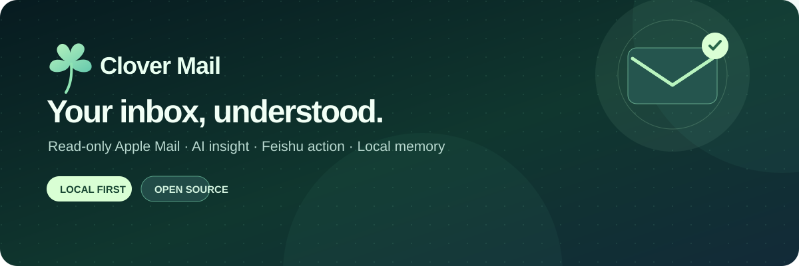

<div align="center">



<h1>Clover Mail</h1>

<p><strong>把多个邮箱的邮件存成一个本地档案，让你自己选的 AI 助手来查询。</strong></p>

<p><a href="README.md">English</a> · <a href="docs/mcp.md">MCP 使用说明</a> · <a href="docs/setup.md">安装配置</a> · <a href="docs/privacy.md">隐私说明</a> · <a href="docs/architecture.md">架构</a></p>

</div>

Clover Mail 把 Apple Mail 已经下载到 Mac 上的邮件复制进一个本地 SQLite 档案。之后你可以在本机搜索这些邮件，用你选择的模型生成中文摘要、翻译和待办，也可以让 Codex、Claude 这类 AI 助手通过一个**只读**的 [MCP](https://modelcontextprotocol.io) 服务来查询。

> **当前状态：Alpha（0.2）。** 维护者本人在 macOS 上实际使用中。功能还不完善，使用前请先看[已知限制](#已知限制)。

## 适合谁

- 有多个邮箱（学校、工作、个人），并且都已经接入了 Mac 自带的 Apple Mail。
- 希望用 AI 帮忙看邮件、找邮件、理待办，但不想把邮箱密码交给第三方服务。
- 会在终端里运行几条命令。目前需要用 Python 安装，还没有图形界面。

## 工作方式

```text
Apple Mail 本地缓存（只读：不会发送、移动、删除或标记任何邮件）
        │  clover-mail sync
        ▼
本地 SQLite 档案  ~/Library/Application Support/CloverMail/
        ├── 关键词搜索和自然语言搜索（命令行）
        ├── 只读 MCP 服务 ──► Codex · Claude · 其他 MCP 客户端
        ├── 可选：AI 分析（摘要、翻译、待办、截止日期）
        ├── 可选：每日简报（先存在本地，可再发到飞书或邮箱）
        └── 可选：镜像到飞书多维表格、Notion
```

邮件档案只存在你的 Mac 上。AI 分析、飞书、Notion、邮件简报都是默认关闭的，只有你自己配置后，对应的数据才会发出去。

## 功能

| 功能 | 做什么 | 需要什么 |
| --- | --- | --- |
| 本地档案 | 导入 Apple Mail 已下载的邮件，自动去重，原始邮件保存在本机 | 给运行它的 Python 开"完全磁盘访问权限" |
| 搜索 | 按主题、发件人、正文和 AI 生成的字段搜索；`ask` 支持用一句话提问 | `ask` 需要配置 AI 供应商 |
| AI 分析 | 中文摘要、翻译、待办事项、截止日期，能读邮件里的图片 | 你自己选择的 AI 供应商 |
| MCP 服务 | 给 AI 助手用的 6 个只读工具（见下文） | 安装时带上 `[mcp]` |
| 每日简报 | 每天生成一份邮件简报存在本地，可选发到飞书或邮箱 | AI 供应商；发送需要飞书或 SMTP |
| 镜像 | 飞书多维表格邮件中心（可在飞书里改处理状态）；Notion 全文镜像 | 你自己的飞书应用或 Notion 集成 |
| 定时任务 | 用 macOS 的 launchd 每 15 分钟同步和分析一次 | 可选 |

**支持的邮箱：** Apple Mail 能接入的都可以，包括 Gmail、Outlook / Microsoft 365（很多学校和公司邮箱用的就是它）、iCloud 和其他 IMAP 邮箱。其中 Gmail 和一个基于 Outlook 的大学邮箱在日常使用中，其他邮箱测试得少一些。

**支持的 AI 供应商：** MiMo、兼容 OpenAI Chat Completions 接口的服务、Anthropic。不配置 AI 也能用档案、搜索和 MCP。

## 快速开始

需要：macOS、至少下载过一封邮件的 Apple Mail、Python 3.11 或更新版本。

```sh
git clone https://github.com/clover475/clover-mail.git
cd clover-mail
python3 -m venv .venv
.venv/bin/python -m pip install -e '.[mcp]'

.venv/bin/clover-mail doctor           # 只统计账户和邮箱数量，不显示邮件内容
.venv/bin/clover-mail sync --days 3    # 第一次导入真实邮件，先只导最近 3 天
.venv/bin/clover-mail search 'invoice' --days 3
.venv/bin/python scripts/check_mcp.py  # 启动 MCP 服务，检查工具是否齐全
```

`doctor` 需要你在 系统设置 → 隐私与安全性 → 完全磁盘访问权限 里勾选你正在用的终端。这个权限范围很大，只给你实际使用的那一个应用。之后按[安装配置](docs/setup.md)添加 AI 供应商、定时任务或其他可选功能。

## 接入 AI 助手

MCP 服务在你的 Mac 上运行，通过标准输入输出（stdio）和客户端通信。下面的路径请换成你上一步创建的虚拟环境的绝对路径。

| 客户端 | 状态 | 怎么接 |
| --- | --- | --- |
| Codex（命令行，或 ChatGPT 桌面端里的 Codex） | ✅ 已实测 | `codex mcp add clover-mail -- /路径/clover-mail/.venv/bin/clover-mail-mcp` |
| Claude Code | ✅ 已实测 | `claude mcp add -s user clover-mail -- /路径/clover-mail/.venv/bin/clover-mail-mcp` |
| Claude Desktop | 已写配置说明，尚未实测 | 在配置文件里加一个 `mcpServers` 条目，见 [MCP 使用说明](docs/mcp.md#claude-desktop) |
| ChatGPT 桌面端 Work mode | 已写配置说明，尚未实测 | 个人本地插件，见 [MCP 使用说明](docs/mcp.md) |
| 网页版 / 普通云端 ChatGPT 对话 | ❌ 不支持 | 云端对话连不到你 Mac 上的程序 |

接好之后可以这样问：

- "用 Clover Mail 汇总我最近 3 天的邮件。"
- "这周学校有没有发重要通知？"
- "我还有哪些邮件需要处理？"
- "找到场地方发来的报价邮件，给我看正文。"
- "帮我起草这封邮件的回复。"（AI 只负责起草，Clover Mail 本身不能发信）

### MCP 工具

| 工具 | 返回什么 |
| --- | --- |
| `mail_list_accounts` | 各邮箱账户的邮件数量和最近同步时间 |
| `mail_get_summary` | 最近邮件、重要邮件和即将到期的截止事项（读已有的 AI 分析结果，不重新调用模型） |
| `mail_search` | 按关键词、发件人、收件人、主题、时间和账户搜索，支持分页 |
| `mail_get_message` | 单封邮件和它的分析结果；正文只在明确要求时返回，并限制长度 |
| `mail_get_pending_actions` | 待办还没完成的邮件 |
| `mail_get_daily_brief` | 已生成的每日简报；没生成就明确说没生成，不会编造 |

所有工具都标记为只读。没有任何工具能发送、删除、移动或修改邮件，也没有工具会触发同步或调用模型。账户默认只显示一串编号，你可以加一个[账户别名文件](docs/mcp.md#optional-account-labels--可选账户别名)，把它们标成 `School`、`Gmail` 这样的名字。

## 隐私与安全

- **对邮件只读。** Clover Mail 从不写入 Apple Mail。
- **默认留在本机。** 邮件档案、密钥配置（`~/.config/clover-mail/`）和账户别名都在你的 Mac 上，权限设为只有你本人能读。
- **每项云端功能单独开启。** AI 供应商、飞书、Notion、SMTP、远程图片各自只接收[隐私说明](docs/privacy.md)里列出的内容，而且只在你配置之后才会发送。
- **AI 助手也会看到数据。** Codex、Claude 或 ChatGPT 读取工具结果时，这些内容会发给对应的 AI 公司。服务在本机运行，不等于完全离线。
- **邮件内容不可信。** 工具结果会标注"这是数据，不是指令"，用来防止邮件里藏着的指令被 AI 执行。AI 提取的日期和待办仍可能出错，重要事项请对照原邮件确认。

发现安全漏洞请私下报告，见 [SECURITY.md](SECURITY.md)。

## 已知限制

- 只支持 macOS 和 Apple Mail。只有 Apple Mail 已经完整下载的邮件才能导入；Apple Mail 的缓存格式没有公开文档，系统升级后可能需要适配。
- MCP 服务只在本机运行，网页版 ChatGPT 用不了。
- 没有保存未读状态，所以不支持只看未读邮件。
- 邮件档案没有加密备份和多设备同步，请开启 FileVault 并做好常规备份。
- 飞书和 Notion 功能需要你自己创建并拥有对应的工作区。

## 路线图

大致按顺序，不承诺具体时间。

1. **按邮箱单独授权。** 每个邮箱分别授权能否存入本地档案、能否交给 AI、能否同步到飞书、Notion 或邮件简报；没有授权时一律不处理。
2. **同步结果说得更清楚。** 报告因为没有授权、或因为在排除文件夹里而跳过的邮件数量；识别中文等本地化名称的垃圾邮件和已删除文件夹。
3. **定时任务更稳。** 没开启的服务直接跳过；某个外部服务出错时不影响其他步骤；每日简报先存到本地再发送。
4. **安装更简单。** 一条命令完成安装，并顺便把 MCP 服务登记到已安装的 AI 客户端。
5. **可选的远程访问。** 经过安全评估后，提供一条用户主动开启的路线，通过 OpenAI 的 Secure MCP Tunnel 接入云端 ChatGPT。

欢迎在 [Issues](https://github.com/clover475/clover-mail/issues) 里提建议。

## 参与贡献

欢迎小而聚焦的 Pull Request。只能使用合成的测试邮件，不要上传真实邮件、邮件档案、密钥或收件箱截图。先读 [CONTRIBUTING.md](CONTRIBUTING.md)。

```sh
PYTHONPATH=src .venv/bin/python -m unittest discover -s tests
```

## 许可证

[MIT](LICENSE) © Clover Mail contributors
